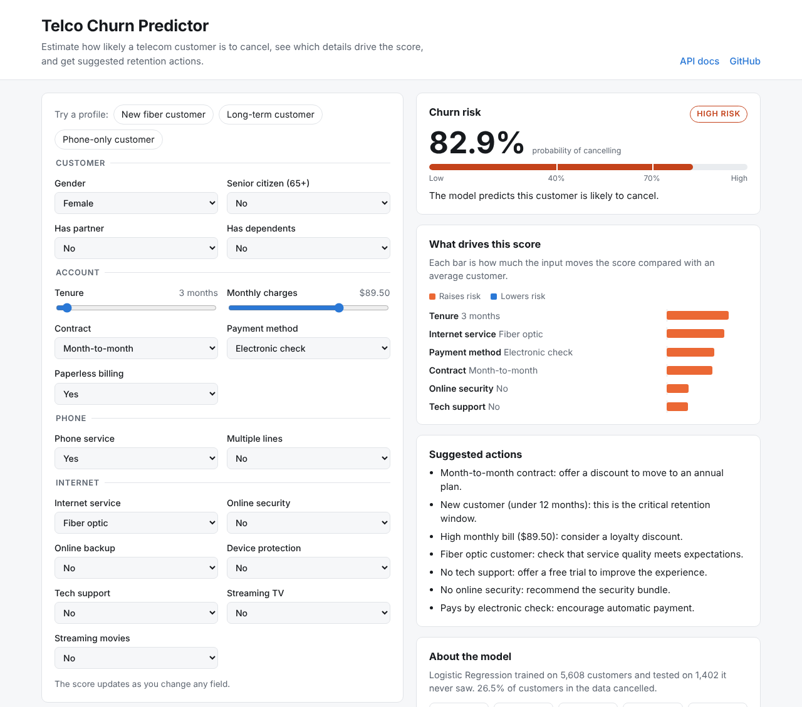
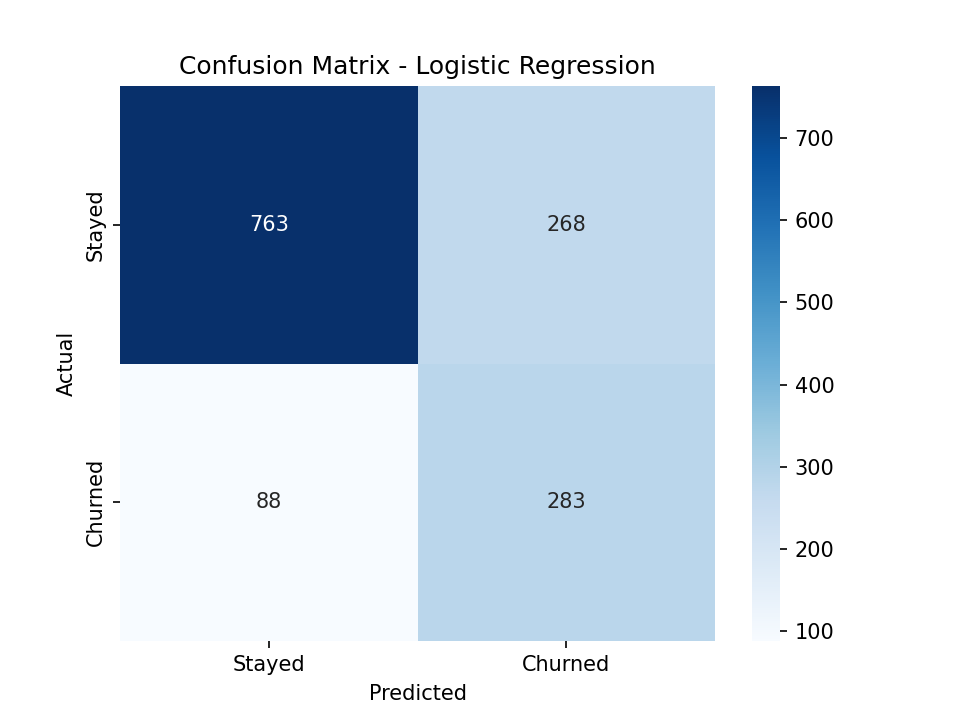
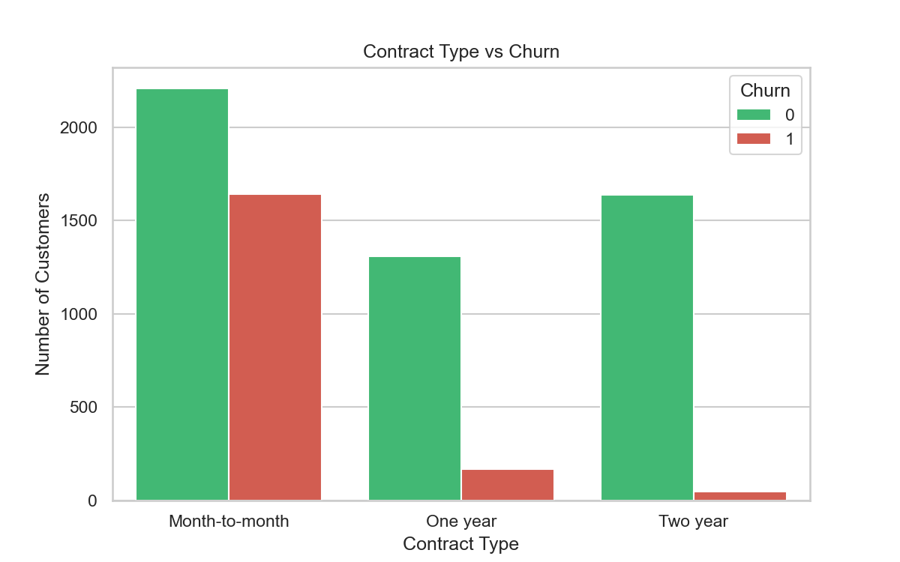
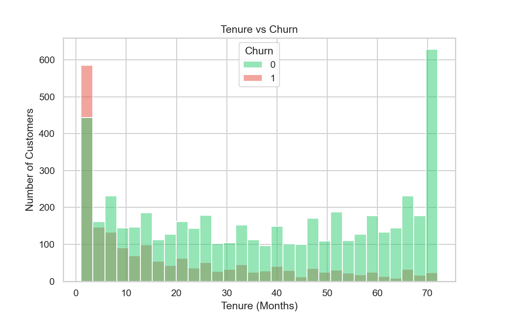

# Telco Customer Churn Predictor

[](https://github.com/IbtissamBukhari/telco-churn-predictor/actions/workflows/ci.yml)

Predicts how likely a telecom customer is to cancel their subscription, explains which details drive that score, and suggests retention actions. Trained on the IBM Telco Customer Churn dataset (7,043 customers) and served through a FastAPI REST API with a web interface.

**Live demo:** https://telco-churn-predictor-62b1.onrender.com (free hosting: the first request after a quiet period can take up to a minute)



---

## Results

The final model is Logistic Regression with balanced class weights. It was chosen over Random Forest and XGBoost because it caught the most churners, and its regularisation strength was tuned with 5-fold cross-validation on recall.

Test set: 1,402 customers the model never saw during training.

| Metric | Score |
|:--|--:|
| Recall | 76.3% |
| Precision | 50.7% |
| F1 score | 60.9% |
| Accuracy | 74.1% |
| ROC-AUC | 0.84 |

| Model (default settings) | Recall | Precision | Accuracy |
|:--|--:|--:|--:|
| **Logistic Regression** | **76.3%** | 51.4% | 74.6% |
| XGBoost | 63.9% | 52.3% | 75.0% |
| Random Forest | 45.6% | 60.6% | 77.7% |

**Why recall:** 26.5% of customers churn. A model that predicts "stays" for everyone is 73.5% accurate and useless. For a retention team, missing a customer who is about to leave costs more than offering a discount to someone who would have stayed, so the model is tuned to catch as many churners as possible. It finds 283 of the 371 churners in the test set, with 275 false alarms.



## What drives churn

| Factor | Churn rate |
|:--|:--|
| Contract | Month-to-month 42.6%, one year 11.3%, two year 2.8% |
| Tenure | First 12 months 47.6%, after 4 years 9.5% |
| Internet service | Fiber optic 41.8%, DSL 18.9%, no internet 7.2% |
| Payment method | Electronic check 45.1%, automatic payments 15 to 17% |
| Monthly bill | Over $70: 35.3%, $70 or less: 17.3% |
| Senior citizens | 41.6% vs 23.5% for other customers |

The model agrees: its largest coefficients are tenure and contract length (both lower risk) and fiber optic internet and electronic check payment (both raise it).





**Business takeaways**

1. The first year is the danger zone. Onboarding and early check-ins matter most.
2. Moving month-to-month customers to annual contracts is the strongest retention lever.
3. Fiber optic customers churn at twice the DSL rate despite paying more, which points to a service quality or pricing problem worth investigating.
4. Customers paying by electronic check churn about three times as often as those on automatic payments.

## Explaining each prediction

For every customer the API returns the inputs that push the score up or down the most. Because the model is linear, these contributions are exact rather than approximated: each one is the coefficient times the difference between this customer's value and the average training customer's value, and together they add up to the model's output. A test checks this.

## API

| Method | Endpoint | Description |
|:--|:--|:--|
| GET | `/` | Web interface |
| POST | `/predict` | Score one customer |
| POST | `/predict/batch` | Score up to 500 customers |
| GET | `/model-info` | Model type and test metrics |
| GET | `/health` | Health check |
| GET | `/docs` | Interactive API documentation |

Example request:

```bash
curl -X POST https://telco-churn-predictor-62b1.onrender.com/predict \
  -H "Content-Type: application/json" \
  -d '{"gender": "Female", "SeniorCitizen": 0, "Partner": "No", "Dependents": "No",
       "tenure": 3, "PhoneService": "Yes", "MultipleLines": "No",
       "InternetService": "Fiber optic", "OnlineSecurity": "No", "OnlineBackup": "No",
       "DeviceProtection": "No", "TechSupport": "No", "StreamingTV": "Yes",
       "StreamingMovies": "No", "Contract": "Month-to-month", "PaperlessBilling": "Yes",
       "PaymentMethod": "Electronic check", "MonthlyCharges": 89.5}'
```

Response (shortened):

```json
{
  "churn_probability": 0.8431,
  "will_churn": true,
  "risk_level": "high",
  "factors": [
    {"feature": "tenure", "label": "Tenure", "value": "3 months", "impact": 0.3833},
    {"feature": "InternetService", "label": "Internet service", "value": "Fiber optic", "impact": 0.3553}
  ],
  "recommendations": [
    "Month-to-month contract: offer a discount to move to an annual plan."
  ]
}
```

Risk levels: high from 70%, medium from 40%, low below 40%. Inputs are validated, including combinations that cannot exist in the data (for example internet add-ons for a customer without internet).

## Pipeline

1. **Data loading** (`01_data_loading.ipynb`): 7,043 customers, 21 columns. `TotalCharges` is stored as text and has 11 blank values.
2. **Cleaning** (`02_data_cleaning.ipynb`, `src/data_loader.py`): drop `customerID`, convert `TotalCharges` to a number, drop the 11 blank rows (all brand-new customers) and 22 duplicates. 7,010 customers remain.
3. **EDA** (`03_eda.ipynb`): churn by contract, tenure, charges, internet service and age.
4. **Feature engineering** (`04_feature_engineering.ipynb`, `src/preprocessor.py`): binary columns to 0/1, one-hot encoding for the rest, tenure and monthly charges scaled to 0-1. `TotalCharges` is dropped because it is close to tenure times monthly charges (correlation with tenure 0.83).
5. **Modelling** (`05_model_building.ipynb`, `src/train.py`): stratified 80/20 split, three models compared, `C` tuned by cross-validation.

`src/train.py` turns the notebooks into one scikit-learn pipeline, so the API applies exactly the preprocessing used in training. In the pipeline the scaler is fitted on the training split only, so no information from the test set leaks into training. It reproduces the notebook results exactly.

## Run locally

Requires Python 3.11.

```bash
git clone https://github.com/IbtissamBukhari/telco-churn-predictor.git
cd telco-churn-predictor
python -m venv venv
source venv/bin/activate          # Windows: venv\Scripts\activate
pip install -r requirements.txt

python -m src.train               # downloads the data and trains the model
uvicorn api.main:app --reload     # open http://localhost:8000
```

The dataset is downloaded from [IBM's public GitHub repository](https://github.com/IBM/telco-customer-churn-on-icp4d), which has the same file as the [Kaggle dataset](https://www.kaggle.com/datasets/blastchar/telco-customer-churn).

With Docker:

```bash
docker build -t telco-churn-predictor .
docker run -p 8000:8000 telco-churn-predictor
```

Tests:

```bash
pip install -r requirements-dev.txt
pytest
```

To run the notebooks, install `requirements-notebooks.txt` and put the CSV in `data/raw/` (or run `python -m src.data_loader`).

GitHub Actions trains the model, checks that the metrics match the ones above, runs the tests, and builds and smoke-tests the Docker image on every push.

## Project structure

```
telco-churn-predictor/
├── api/
│   ├── main.py               FastAPI app
│   └── schemas.py            Request and response validation
├── frontend/                 Web interface (HTML, CSS, JavaScript)
├── src/
│   ├── data_loader.py        Download and clean the data
│   ├── preprocessor.py       Feature definitions and encoding
│   ├── train.py              Train, evaluate and save the model
│   └── predictor.py          Predictions, explanations and recommendations
├── notebooks/                01 to 05: analysis and model development
├── models/metrics.json       Test metrics of the trained model
├── outputs/figures/          Charts from the analysis
├── tests/                    Model and API tests
├── Dockerfile
└── render.yaml               Render deployment
```

## Limitations

- The data is a single snapshot from IBM's sample dataset for a fictional telecom company, so the model demonstrates the approach rather than being ready for a real company's customers.
- Precision is about 51%: roughly half of the customers flagged as likely to leave would have stayed. The 0.5 threshold could be raised if retention offers are expensive.
- No information about why customers leave (complaints, outages, competitor offers), which would likely improve the model.

## Tech stack

Python, Pandas, scikit-learn, XGBoost, Matplotlib, Seaborn, FastAPI, Pydantic, Docker, GitHub Actions, Render

## Author

**Syed Ali Ibtissam Bukhari**
[GitHub](https://github.com/IbtissamBukhari) · [LinkedIn](https://www.linkedin.com/in/ibtissambukhari)
